<p align="center">
  
</p>

<p align="center">
  <a href="https://github.com/ishandutta2007Awesome-Awesome-Awesome"></a>
  <a href="https://discord.gg/jc4xtF58Ve"></a>
  <a href="https://github.com/ishandutta2007/Awesome-Business-Process-Testing/stargazers"></a>
  <a href="https://github.com/ishandutta2007/Awesome-Business-Process-Testing/network/members"></a>
  <a href="https://github.com/ishandutta2007/Awesome-Business-Process-Testing/issues"></a>
  <a href="https://github.com/ishandutta2007/Awesome-Business-Process-Testing/pulls"></a>
  <a href="https://github.com/ishandutta2007/Awesome-Business-Process-Testing/blob/main/LICENSE"></a>
  <a href="https://github.com/ishandutta2007"></a>
</p>

---

# 🚀 Awesome Business Process Testing (BPT)

> **The definitive, curated directory of enterprise Business Process Testing (BPT) SaaS platforms, codeless automation engines, and open-source testing frameworks.**  
> Validate mission-critical enterprise workflows—spanning **SAP S/4HANA, Salesforce, ServiceNow, Oracle Cloud, Workday, Citrix, and custom web/mobile apps**—ensuring seamless zero-defect releases across interconnected business ecosystems.

**Last updated:** October 2026 | **Curated by:** [@ishandutta2007](https://github.com/ishandutta2007)

---

## 📑 Table of Contents

- [🎯 What is Business Process Testing?](#-what-is-business-process-testing)
- [📊 Sector Overview & Market Dynamics](#-sector-overview--market-dynamics)
- [🏢 SaaS & Enterprise Testing Platforms](#-saas--enterprise-testing-platforms)
  - [Enterprise SaaS Comparison Table](#-enterprise-saas-comparison-table)
  - [Detailed SaaS Profiles](#-detailed-saas-profiles)
- [🌐 Open-Source Testing Frameworks](#-open-source-testing-frameworks)
  - [Open-Source Solutions Ranked by GitHub_Stars](#-open-source-solutions-ranked-by-github-stars)
- [🧭 Decision Matrix: SaaS vs. Open-Source](#-decision-matrix-saas-vs-open-source)
- [🤝 How to Contribute](#-how-to-contribute)
- [💖 Support & Community](#-support--community)
- [📈 Star History](#-star-history)
- [⚖️ Disclaimer & License](#-disclaimer--license)

---

## 🎯 What is Business Process Testing?

**Business Process Testing (BPT)** is a quality engineering discipline focused on validating that interconnected business workflows operate seamlessly from inception to completion. Unlike traditional unit or single-page UI testing, BPT validates multi-system transactions across enterprise boundaries:

- 📦 **Order-to-Cash (O2C):** Web storefront ➔ Salesforce CRM ➔ SAP S/4HANA ERP ➔ Logistics ➔ Payment Gateway.
- 📑 **Procure-to-Pay (P2P):** ServiceNow Service Catalog ➔ Coupa Procurement ➔ Oracle Financials.
- 👥 **Hire-to-Retire (H2R):** Workday HCM ➔ Active Directory / Okta ➔ ServiceNow ITSM ➔ Payroll.

---

## 📊 Sector Overview & Market Dynamics

The global **Business Process Testing (BPT) and automated enterprise quality engineering market** is estimated at **$28.5 billion in 2024** and is projected to surpass **$68.2 billion by 2030**, advancing at a robust compound annual growth rate (**CAGR of ~16.5%**).

The market exhibits **moderate fragmentation**:
- **Concentrated Enterprise Core:** Tier-1 core platforms (SAP, Salesforce, ServiceNow, and Oracle) have concentrated testing around specialized enterprise vendors—such as **Tricentis**, **Worksoft**, and **Copado**—through deep OEM integrations, packaged application accelerators, and certified partner ecosystems.
- **Dynamic Fragmented Frontier:** Concurrently, rapid enterprise adoption of cloud migrations, microservices, and AI-driven codeless automation has allowed specialized platforms (e.g., **UiPath Test Suite**, **Katalon**, **Leapwork**) and powerhouse open-source libraries (**Playwright**, **Robot Framework**, **Cypress**) to capture significant market share for agile, continuous CI/CD pipelines.

---

## 🏢 SaaS & Enterprise Testing Platforms

Enterprise SaaS and commercial testing suites are engineered for multi-system resilience, packaged business applications, audit-compliant reporting, and codeless maintenance.

### 📊 Enterprise SaaS Comparison Table

> *Note: Ranked in descending order by company valuation / market capitalization.*

| 🏢 Platform & Vendor | 🌐 Company Size (Valuation / Revenue) | 💵 Starting Tier Pricing | 🎁 Free Tier & Trial Limits | 🎯 Key Ecosystem Focus |
| :--- | :--- | :--- | :--- | :--- |
| **[ServiceNow ATF & BPT](https://www.servicenow.com/)** | **~$185B Market Cap**<br>*(~$10.0B ARR)* | **$100 / user / month**<br>*(Bundled in Enterprise ITSM from ~$30,000/yr)* | **Free Forever Developer Instance (PDI)**<br>*(1 full admin instance via developer.servicenow.com; reclaims after 10 days of inactivity)* | ServiceNow ITSM, CSM, HR Service Delivery, and custom App Engine workflows. |
| **[Keysight Eggplant](https://www.keysight.com/)** | **~$28B Market Cap**<br>*(~$5.0B ARR)* | **$3,500 / year**<br>*(Per execution license engine, DAI Starter tier)* | **30-Day Guided Free Trial**<br>*(2 concurrent test execution bots + access to Eggplant DAI AI-model sandbox)* | Non-intrusive computer vision & OCR across Citrix, RDP, POS, CAD, ERP, and medical systems. |
| **[OpenText UFT One](https://www.microfocus.com/)** | **~$8.5B Market Cap**<br>*(~$5.8B ARR)* | **$3,200 / year**<br>*(Per named user seat; runtime engine from $1,600/yr)* | **30-Day Fully Functional Trial**<br>*(No credit card required; full access to desktop, web, SAP GUI, and API engines)* | Legacy-to-cloud enterprise applications, SAP GUI, Oracle EBS, Mainframe, and hybrid desktop apps. |
| **[UiPath Test Suite](https://www.uipath.com/)** | **~$6.5B Market Cap**<br>*(~$1.4B ARR)* | **$420 / month ($5,040 / year)**<br>*(Automation Developer Pro seat; Enterprise bundles ~$15,000/yr)* | **60-Day Enterprise Trial + Community Free Forever**<br>*(Community plan includes 2 attended bots + 1 unattended bot with Studio Pro free forever)* | Robotic Process Automation (RPA) combined with testing across 190+ UI/API technologies and SAP S/4HANA migrations. |
| **[Tricentis Tosca](https://www.tricentis.com/)** | **~$4.5B Valuation**<br>*(~$350M+ ARR)* | **$12,500 / year**<br>*(Tosca Cloud Starter; Enterprise on-premise suites start ~$70,000+/yr)* | **14-Day Free Cloud Trial**<br>*(Tricentis Testim / Tosca Cloud with up to 1,000 test runs and 1 shared workspace)* | SAP Signavio and SAP Cloud ALM native integration, Model-Based Test Automation (MBTA), and Agentic AI. |
| **[SmartBear TestComplete](https://smartbear.com/)** | **~$2.5B Valuation**<br>*(~$300M+ ARR)* | **$4,836 / year**<br>*(Base module node-locked; floating license at $8,375/yr)* | **14-Day Full-Featured Free Trial**<br>*(Unrestricted access to Web, Mobile, and Desktop modules with AI object recognition)* | Scripted and scriptless testing, Gherkin BDD scenarios via CucumberStudio, cross-desktop/web workflows. |
| **[Copado Robotic Testing](https://www.copado.com/)** | **~$1.2B Valuation**<br>*(~$75M+ ARR)* | **$1,200 / user / year**<br>*(Copado CRT seat; Enterprise CI/CD suites start ~$80,000/yr for 20 seats)* | **30-Day Free Trial**<br>*(Up to 100 cloud test runs, 2 concurrent runners, and Salesforce cloud sandbox access)* | Salesforce multi-cloud, low-code QWords keywords, self-healing locators, and automated DevOps deployment gates. |
| **[Leapwork](https://www.leapwork.com/)** | **~$350M+ Valuation**<br>*(~$50M+ ARR)* | **$1,500 / month ($18,000 / year)**<br>*(Starter tier; Enterprise configurations average ~$6,300/mo)* | **14-Day Fully Supported Trial**<br>*(Up to 5 visual flowchart automation flows with Smart Visual Recorder assistance)* | Codeless visual flowchart automation across Citrix, Remote Desktops, SAP ERP, Dynamics 365, and web apps. |
| **[Worksoft Certify](https://www.worksoft.com/)** | **~$300M Valuation**<br>*(~$80M+ ARR)* | **$15,000 / year**<br>*(Certify Starter tier; full multi-system enterprise suites start ~$50,000/yr)* | **14-Day Guided Proof-of-Concept**<br>*(Includes automated process discovery and connectivity to 1 live ERP sandbox)* | Continuous automated business process discovery and testing across SAP, Salesforce, ServiceNow, Oracle, and Workday. |
| **[Katalon Studio](https://katalon.com/)** | **~$150M+ Valuation**<br>*(~$40M+ ARR)* | **$146 / month ($1,752 / year)**<br>*(Studio Enterprise billed annually; Runtime Engine from $1,399/yr)* | **Free Forever Plan (Studio Free)**<br>*(Includes up to 2,000 monthly test execution results, 5 active test cases per suite, and community support)* | Unified all-in-one testing for Web, API, Mobile, and Windows Desktop with AI-assisted self-healing locators. |

---

### 🔍 Detailed SaaS Profiles

#### 1. 🏢 ServiceNow Automated Test Framework (ATF) & BPT
- **Website:** [servicenow.com](https://www.servicenow.com/)
- **Pricing:** Starts at $100/user/month (included in enterprise platform contracts starting at ~$30,000/year).
- **Free Tier:** Free Developer Instance (PDI) with administrative rights and full ATF access at [developer.servicenow.com](https://developer.servicenow.com/) (active indefinitely if accessed within 10 days).
- **Description:** Business process testing in ServiceNow validates end-to-end IT service requests, approval matrices, role/ACL security boundaries, and data handoffs. ATF eliminates manual regression overhead across ServiceNow family upgrades and update sets.

#### 2. 👁️ Keysight Eggplant
- **Website:** [keysight.com](https://www.keysight.com/)
- **Pricing:** Starts at $3,500/year per execution license (DAI Starter).
- **Free Tier:** 30-day guided free trial with 2 execution bots and Digital Automation Intelligence sandbox.
- **Description:** Uses optical character recognition (OCR) and non-invasive computer vision to automate processes from the user's perspective. It interacts seamlessly with locked environments like Citrix, mainframe emulators, and medical workstations without requiring underlying code access.

#### 3. 🛡️ OpenText UFT One (formerly Micro Focus UFT)
- **Website:** [microfocus.com](https://www.microfocus.com/)
- **Pricing:** Starts at $3,200/year per named user seat; runtime execution engines start at $1,600/year.
- **Free Tier:** 30-day unrestricted trial with full access to desktop, web, SAP GUI, and API modules.
- **Description:** The industry standard for legacy enterprise systems. Offers robust parameter passing across multi-stage business workflows, automated data injection, and support for over 200 enterprise technologies.

#### 4. 🤖 UiPath Test Suite
- **Website:** [uipath.com](https://www.uipath.com/)
- **Pricing:** Starts at $420/month ($5,040/year) for Automation Developer Pro.
- **Free Tier:** 60-day Enterprise trial + Community Edition free forever (includes 2 attended robots and 1 unattended robot).
- **Description:** Unifies software testing with enterprise RPA. Enables teams to reuse automated business workflows built for production automation directly as regression and smoke test cases for SAP S/4HANA migrations and cross-cloud transactions.

#### 5. 🎯 Tricentis Tosca
- **Website:** [tricentis.com](https://www.tricentis.com/)
- **Pricing:** Starts at $12,500/year for Tosca Cloud Starter; enterprise on-premise suites start at ~$70,000+/year.
- **Free Tier:** 14-day free cloud trial with up to 1,000 test executions and 1 workspace.
- **Description:** Category-leading Model-Based Test Automation (MBTA) platform. Synchronizes directly with SAP Signavio and SAP Cloud ALM, allowing business analysts to construct executable test cases without scripting.

#### 6. ⚡ SmartBear TestComplete
- **Website:** [smartbear.com](https://smartbear.com/)
- **Pricing:** Starts at $4,836/year for node-locked Base module; floating seat at $8,375/year.
- **Free Tier:** 14-day full-featured free trial with Web, Desktop, and Mobile engines.
- **Description:** Offers flexible test creation via record-and-replay, JavaScript/Python/VBScript scripting, or Gherkin BDD syntax via CucumberStudio. Ideal for multi-tier desktop applications integrated with web portals.

#### 7. ☁️ Copado Robotic Testing
- **Website:** [copado.com](https://www.copado.com/)
- **Pricing:** Starts at $1,200/user/year; enterprise DevOps CI/CD packages range from $80,000–$150,000/year for 20 users.
- **Free Tier:** 30-day trial with 100 cloud execution runs and 2 concurrent runners.
- **Description:** Salesforce-native automated testing with human-readable QWords keywords. Automatically detects Salesforce DOM variations, dynamic Shadow DOM components, and seasonal release updates with self-healing AI.

#### 8. 🧩 Leapwork
- **Website:** [leapwork.com](https://leapwork.com/)
- **Pricing:** Starts at $1,500/month ($18,000/year) for Starter; enterprise deployments average ~$6,300/month.
- **Free Tier:** 14-day fully supported trial with 5 visual automation flows.
- **Description:** Entirely visual, flowchart-driven testing platform designed for non-technical domain experts and business analysts. Operates across web browsers, Windows desktop software, Citrix virtual desktops, and ERP portals.

#### 9. 🔄 Worksoft Certify
- **Website:** [worksoft.com](https://www.worksoft.com/)
- **Pricing:** Starts at $15,000/year for Certify Starter; enterprise deployments range from $50,000+/year.
- **Free Tier:** 14-day guided proof-of-concept trial upon request with 1 connected ERP test sandbox.
- **Description:** Built specifically for complex SAP and cross-application enterprise landscapes (SAP S/4HANA, Salesforce, Oracle, Workday). Discovers real employee business workflows and automatically generates maintainable, codeless regression suites.

#### 10. 🧪 Katalon Studio
- **Website:** [katalon.com](https://katalon.com/)
- **Pricing:** Starts at $146/month ($1,752/year) for Studio Enterprise; Runtime Engine starts at $1,399/year.
- **Free Tier:** Free Forever tier (Studio Free) with 2,000 monthly test execution results and 5 active test cases per suite.
- **Description:** Combines low-code recording with full-code extensibility (Java/Groovy). Unifies web, mobile, API, and Windows desktop testing in a single IDE with AI-powered locator maintenance.

---

## 🌐 Open-Source Testing Frameworks

Open-source frameworks provide total infrastructure sovereignty, zero per-seat licensing costs, and complete flexibility for engineering teams building custom business workflow validation engines.

### 🌟 Open-Source Solutions Ranked by GitHub_Stars

> *Note: Ranked in descending order of stargazers count. Click the Stars_Badge beside any repository to inspect its stargazers.*

---

#### 1. 🎭 [Microsoft Playwright](https://github.com/microsoft/playwright) [](https://github.com/microsoft/playwright/stargazers)
- **Primary Languages:** TypeScript / JavaScript / Python / C# / Java
- **License:** Apache-2.0
- **Ecosystem Role in BPT:** Modern cross-browser orchestration framework featuring auto-waiting, network payload mocking, video/trace recordings, and native multi-tab/multi-role context isolation. Outstanding for complex multi-persona web approval processes.

#### 2. 🤖 [Google Puppeteer](https://github.com/puppeteer/puppeteer) [](https://github.com/puppeteer/puppeteer/stargazers)
- **Primary Languages:** TypeScript / JavaScript
- **License:** Apache-2.0
- **Ecosystem Role in BPT:** Headless Chrome and Chromium control library. Ideal for synthetic transaction monitoring, automated PDF invoice generation validation, and background headless business step verification.

#### 3. 🌲 [Cypress](https://github.com/cypress-io/cypress) [](https://github.com/cypress-io/cypress/stargazers)
- **Primary Languages:** JavaScript / TypeScript
- **License:** MIT
- **Ecosystem Role in BPT:** Developer-centric front-end and API testing framework with real-time browser reloading, time-travel debugging, and automatic waiting. Widely used for validating modern SaaS customer portals and checkout funnels.

#### 4. 🌐 [Selenium](https://github.com/seleniumhq/selenium) [](https://github.com/seleniumhq/selenium/stargazers)
- **Primary Languages:** Java / Python / C# / Ruby / JavaScript
- **License:** Apache-2.0
- **Ecosystem Role in BPT:** The foundational W3C WebDriver standard for browser automation. Backs countless enterprise grid architectures and serves as the underlying automation driver for commercial solutions like Katalon.

#### 5. 📱 [Appium](https://github.com/appium/appium) [](https://github.com/appium/appium/stargazers)
- **Primary Languages:** JavaScript / TypeScript
- **License:** Apache-2.0
- **Ecosystem Role in BPT:** Cross-platform mobile automation framework (iOS, Android, Windows). Crucial for end-to-end business processes that originate or complete on mobile devices (e.g., driver delivery apps, 2FA push approvals).

#### 6. 🤖 [Robot Framework](https://github.com/robotframework/robotframework) [](https://github.com/robotframework/robotframework/stargazers)
- **Primary Languages:** Python
- **License:** Apache-2.0
- **Ecosystem Role in BPT:** Keyword-driven and tabular test automation framework. Excellent for business analysts and QA teams building human-readable end-to-end process suites across web (Selenium/Playwright), SAP GUI, database transactions, and APIs.

#### 7. 🦉 [Nightwatch.js](https://github.com/nightwatchjs/nightwatch) [](https://github.com/nightwatchjs/nightwatch/stargazers)
- **Primary Languages:** JavaScript / TypeScript
- **License:** MIT
- **Ecosystem Role in BPT:** End-to-end testing solution powered by Node.js with built-in test runner, assertions, and mock server support. Integrates smoothly with BrowserStack and Sauce Labs for cross-browser process verification.

#### 8. 🥋 [Karate](https://github.com/karatelabs/karate) [](https://github.com/karatelabs/karate/stargazers)
- **Primary Languages:** Java
- **License:** MIT
- **Ecosystem Role in BPT:** Unified framework combining API test automation, performance testing, and UI automation using simple domain-specific language (DSL). Essential for validating complex backend API chains connecting ERPs.

#### 9. 📊 [Allure Report 2](https://github.com/allure-framework/allure2) [](https://github.com/allure-framework/allure2/stargazers)
- **Primary Languages:** Java
- **License:** Apache-2.0
- **Ecosystem Role in BPT:** Multi-language test reporting framework that converts technical test logs into executive business process timelines, failure categorizations, and flaky test diagnostics.

#### 10. 🎯 [Taiko](https://github.com/getgauge/taiko) [](https://github.com/getgauge/taiko/stargazers)
- **Primary Languages:** JavaScript
- **License:** Apache-2.0
- **Ecosystem Role in BPT:** Smart browser automation library with an intuitive, readable API that handles implicit waits and dynamic element loading without explicit timers.

#### 11. 📐 [ThoughtWorks Gauge](https://github.com/getgauge/gauge) [](https://github.com/getgauge/gauge/stargazers)
- **Primary Languages:** Go / C# / Java / JavaScript / Python / Ruby
- **License:** Apache-2.0
- **Ecosystem Role in BPT:** Markdown-based test specification framework. Allows business analysts and QA engineers to write test specifications in plain Markdown while developers implement the underlying glue code.

#### 12. 🥒 [Cucumber JVM](https://github.com/cucumber/cucumber-jvm) [](https://github.com/cucumber/cucumber-jvm/stargazers)
- **Primary Languages:** Java
- **License:** MIT
- **Ecosystem Role in BPT:** The quintessential Behavior-Driven Development (BDD) tool using Gherkin syntax (`Given-When-Then`). Bridges the communication gap between business owners and technical automation engineers.

#### 13. ⚡ [Testsigma](https://github.com/testsigmahq/testsigma) [](https://github.com/testsigmahq/testsigma/stargazers)
- **Primary Languages:** Java
- **License:** Apache-2.0
- **Ecosystem Role in BPT:** Open-source low-code test automation platform for Web, Mobile, and APIs. Enables teams to write tests in plain English with self-hosted containerized deployment.

#### 14. 👑 [Serenity BDD](https://github.com/serenity-bdd/serenity-core) [](https://github.com/serenity-bdd/serenity-core/stargazers)
- **Primary Languages:** Java
- **License:** Apache-2.0
- **Ecosystem Role in BPT:** Living documentation library for Selenium and Playwright. Generates rich, illustrated reports documenting what business features were tested and how they behaved.

#### 15. 🍋 [Citrus Framework](https://github.com/citrusframework/citrus) [](https://github.com/citrusframework/citrus/stargazers)
- **Primary Languages:** Java
- **License:** Apache-2.0
- **Ecosystem Role in BPT:** Automated integration testing framework for messaging protocols (HTTP REST, SOAP, Kafka, JMS, TCP/IP). Perfectly tailored for enterprise ESB, middleware, and backend workflow validation.

---

## 🧭 Decision Matrix: SaaS vs. Open-Source

| Evaluation Criteria | 🏢 Enterprise SaaS (Worksoft, Tricentis, Copado) | 🌐 Open-Source (Robot, Playwright, Gauge) |
| :--- | :--- | :--- |
| **Upfront Cost** | High ($15K – $100K+ / year) | Zero licensing cost (FOSS) |
| **Setup & Maintenance** | Low-code, pre-built packaged application adapters | Requires developer engineering & framework building |
| **SAP / ERP Specialized Support** | Native (SAP GUI scripting, RFC, BAPI, Cloud ALM) | Requires custom connectors or 3rd party plugins |
| **Non-Technical User Adoption** | High (Visual flowcharts, plain English, recorder) | Moderate (Gherkin / Markdown BDD required) |
| **CI/CD Integration Speed** | Out-of-the-box or via Enterprise Orchestrators | Instant integration with GitHub Actions, GitLab, Jenkins |
| **Vendor Lock-in** | High (proprietary object repositories) | None (standard open-source code & libraries) |

---

## 🤝 How to Contribute

Contributions from QA engineers, enterprise test architects, and software developers are warmly encouraged!

1. 🍴 **Fork the repository** on GitHub.
2. 🌿 **Create a new feature branch:**
   ```bash
   git checkout -b feature/add-new-testing-tool
   ```
3. 📝 **Add your entry** in the appropriate section following the existing table or list format (include exact pricing/limits or Stars_Badge).
4. 💾 **Commit your changes:**
   ```bash
   git commit -m "docs: add [Tool Name] to business process testing list"
   ```
5. 🚀 **Push to your branch and submit a Pull Request** with a brief summary of the tool.

---

## 💖 Support & Community

If you find **Awesome Business Process Testing** helpful for your organization, testing strategy, or enterprise architecture, please consider supporting this project:

- ⭐ **Star this repository** to improve its visibility and help other QA engineers discover it.
- 🍴 **Fork and share** with colleagues across LinkedIn, Reddit, Discord, and engineering teams.
- ☕ **Sponsor the Maintainer:** Support continued curation and open-source updates via the [GitHub Sponsors Dashboard](https://github.com/sponsors/ishandutta2007).

Thank you for championing zero-defect software and reliable enterprise workflows! 🌟

---

## 📈 Star History

[](https://star-history.dera.page/#ishandutta2007/Awesome-Business-Process-Testing&type=date&legend=top-left)

---

## ⚖️ Disclaimer & License

- **Disclaimer:** All product names, logos, brands, and registered trademarks belong to their respective owners. Mentioning SaaS products does not constitute an endorsement.
- **Data Compliance:** Enterprise test execution against production-like environments must strictly comply with corporate data governance and privacy regulations (GDPR, HIPAA, SOC 2). Anonymized synthetic test data is strongly advised.
- **Awesome List Heritage:** Part of the curated ecosystem at [Awesome-Awesome-Awesome](https://github.com/ishandutta2007/Awesome-Awesome-Awesome).
- **License:** Distributed under the [MIT License](https://github.com/ishandutta2007/Awesome-Business-Process-Testing/blob/main/LICENSE). Built with ❤️ for the global testing community.
